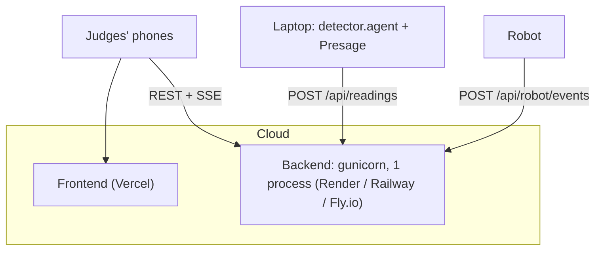
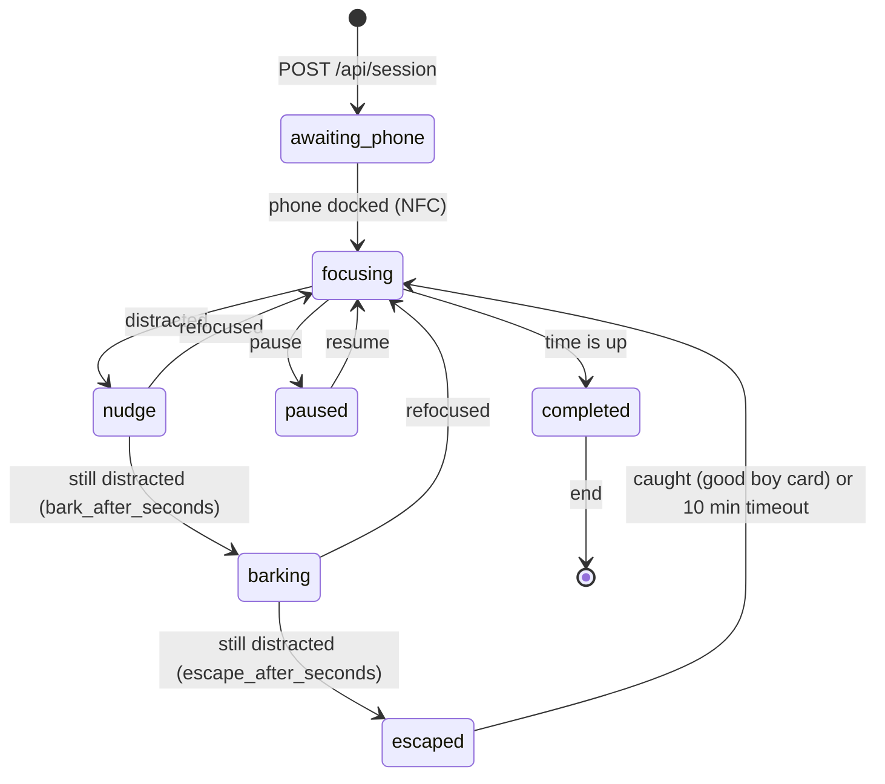

# Fido backend

Flask backend for Fido, the OxHack '26 focus robot dog. It is the single source
of truth for the focus session: every phone, laptop, camera, and the robot read
and change state through it.

The detection logic is Vayun's prototype
([`archive/oxhack26-prototype`](../archive/oxhack26-prototype), from
[vayunk/Oxhack26](https://github.com/vayunk/Oxhack26) at `9e49425`), ported
without changing its thresholds or timers.

> [!IMPORTANT]
> **Presage vitals come from a short 25-second scan, not a live feed.**
> The SmartSpectra SDK runs on the laptop but is **not offline**: it
> authenticates with Presage's servers and spends credits while it measures
> (about one credit per 25-30 s). So, as in the prototype,
> `presage/test_presage.mjs` does one 25-second scan (one credit) and saves
> pulse, breathing and HRV. Those numbers are a snapshot from that scan; they
> do not update during a session. The scan needs a still, front-facing face
> at 25+ fps, and in 25 s usually yields pulse only (breathing needs 30 s, HRV
> 60 s). Focus detection itself (MediaPipe + OpenCV) is fully local and free.
> See [Presage vitals](#presage-vitals).

```
laptop / dog webcam                         phones + laptop browsers
 detector/agent.py  --POST /api/readings-->  +-----------+  <--REST + SSE /api/events--
 presage/test_presage.mjs -> vitals file    |  fido/    |
                                            |  (Flask)  |  <--POST /api/robot/events--  robot
                                            +-----------+  --reply: mode, motion------>
```

| Part | What it does |
| --- | --- |
| `fido/engine.py` | Session state machine: lock-in, sentry, heist, rescue. Pure Python, unit-tested. |
| `fido/app.py` | HTTP API, Server-Sent Events, device token. |
| `detector/focus.py` | Prototype detector: MediaPipe face geometry + YES / NO timers. |
| `detector/agent.py` | Runs the detector on a camera and reports to the backend. |
| `presage/` | Presage SmartSpectra harness, as in the prototype. |

## Run it locally

Requires Python 3.11+ (tested on 3.13). From this directory:

```sh
python3 -m venv .venv
.venv/bin/pip install -r requirements-dev.txt -r requirements-detector.txt

.venv/bin/python -m fido                 # backend on http://0.0.0.0:5000
.venv/bin/python -m detector.agent       # laptop webcam -> backend (press q to quit)
.venv/bin/python -m pytest               # tests
```

Or everything at once with a simulated robot (heartbeat; dock and good-boy
card via the printed curl commands), short escalation timings, and the
detector on the webcam or a looping video:

```sh
sh scripts/demo.sh          # webcam 0
sh scripts/demo.sh clip.mp4 # recorded video instead of a webcam
```

More detector options:

```sh
.venv/bin/python -m detector.agent --source dog --camera 1                # a second USB webcam
.venv/bin/python -m detector.agent --source dog --camera http://<cam>/stream  # network camera (MJPEG/RTSP)
.venv/bin/python -m detector.agent --server https://<hosted-backend> --headless
.venv/bin/python -m detector.agent --source replay --camera clip.mp4     # loop a recording, no webcam needed
```

The agent analyses every frame the camera delivers, at the camera's full rate
(the prototype did the same), and reports the decision about 5 times a
second, or immediately when YES / NO flips. Each new session starts with a
fresh 30-frame posture calibration, so look at the screen when a session
starts. Frames never leave the machine running the agent.

With no robot yet, set `require_dock` to `false` (see Settings) so sessions
start without docking the phone.

### Presage vitals

The same setup as the prototype:

```sh
cd presage
npm install
echo "SMARTSPECTRA_API_KEY=<your key>" > .env    # gitignored
npm run test-safe
```

The harness runs for 25 seconds, which uses one credit, then writes
`detector/presage_vitals.json`. The detector agent shows those vitals on its
preview and forwards them, so they appear under `vitals` in the state.
Presage is not fully local: the SDK runs on this machine, but it authenticates
and counts credits against Presage's servers, so it needs internet access.

Getting real numbers out of the 25-second scan (from testing):

- **One person, facing the camera, holding still, in good light.** The SDK
  repeats "Hold still and record." and returns nothing while the face moves.
- **At least 25 fps.** Below that it only says "Use a camera mode that provides
  at least 25 frames per second". Dim light lowers webcam fps.
- **Pulse needs about 12 s of good signal, breathing 30 s, HRV 60 s.** A
  25-second scan reliably gives pulse at best; breathing and HRV often stay
  empty (`null`, shown as `--`).
- The webcam must be free: stop `detector.agent` while the scan runs, since
  both open the same camera.

## Deploy

Not deployed yet; this is the plan. Only the Flask server is hosted. The
detector agent and Presage stay on the laptop next to the camera and talk to
the hosted URL.



Why one always-on process: the session lives in memory and browsers hold
long-lived SSE connections. **Vercel's Python functions do not fit**: they
are stateless and short-lived, so state is lost between requests and SSE
streams are cut off. The frontend can stay on Vercel.

`requirements.txt` holds only Flask and gunicorn; camera and ML dependencies
are in `requirements-detector.txt` and are not installed on the server.

### Steps (any of Render, Railway, Fly.io; Render shown)

1. **Create the service.** New Web Service from the GitHub repo, branch
   with the backend merged.
   - Root directory: `backend`
   - Build command: `pip install -r requirements.txt`
   - Start command: `gunicorn -c gunicorn.conf.py fido.wsgi:app` (same as the
     Procfile; Railway picks the Procfile up automatically)
   - Instance: the smallest always-on plan. Free tiers that sleep when idle
     add a cold start of up to a minute and drop the session.
   - Exactly **one instance**: do not enable autoscaling or multiple workers,
     or each instance will hold a different session.
2. **Set environment variables** (table below). Generate the device token with
   `python3 -c "import secrets; print(secrets.token_urlsafe(24))"`.
3. **Check it**: `curl https://<backend>/api/health` returns `{"ok":true}`, and
   `curl -N https://<backend>/api/events` prints a `state` event right away
   (if it hangs, the host is buffering SSE; the app already sends
   `X-Accel-Buffering: no`).
4. **Point the frontend at it**: set `NEXT_PUBLIC_FIDO_API=https://<backend>`
   in the Vercel project and redeploy. Set `FIDO_CORS_ORIGIN` on the backend
   to the Vercel URL.
5. **Point the laptop at it**:
   `FIDO_DEVICE_TOKEN=<token> .venv/bin/python -m detector.agent --server https://<backend>`.
   The robot sends the same token in `Authorization: Bearer <token>`.

The frontend on HTTPS cannot call a plain-HTTP backend (mixed content), so
the hosted backend must be HTTPS. All three hosts provide HTTPS by default.

Environment variables:

| Variable | Default | Purpose |
| --- | --- | --- |
| `PORT` | `5000` | Listen port (set by most hosts). |
| `FIDO_DEVICE_TOKEN` | unset | If set, the robot and detector agents must send `Authorization: Bearer <token>`. Set it on any public deployment. |
| `FIDO_CORS_ORIGIN` | `*` | Allowed browser origin, e.g. the frontend's Vercel URL. |
| `FIDO_THREADS` | `64` | Concurrent requests and open SSE streams. |

State is not persisted: a restart clears the current session and history.
See [Database](#database).

## How a session works



- **Distracted** means any live, calibrated camera says NO (the prototype's
  rules: looking at the phone or lap, looking up or away, eyes closed for 4 s,
  talking for 2 s, no face), or the phone left the dock.
- **Escaped** keeps running even if the user refocuses. It ends only when the
  user catches the dog and taps the NFC "good boy" card (or marks it caught
  in the app), or after `escape_timeout_seconds` (10 minutes). After that,
  `recover_grace_seconds` gives the user time to sit back down before
  watching resumes.
- Pausing is allowed until the dog escapes; it stops the clock and escalation.
- The session clock starts when the phone is docked and runs in every watching
  phase, including escaped.

## API

All bodies are JSON. Errors are `{"error": "..."}` with status 400 (bad input)
or 409 (does not apply now; also includes the current `state`, so the client
can resync).

### App (browsers)

| Method | Path | Body | Returns |
| --- | --- | --- | --- |
| GET | `/api/state` | | State snapshot |
| GET | `/api/events` | | SSE stream: one `state` event now and one per change |
| POST | `/api/session` | `{"task": str, "duration_minutes": int}` | 201 + state |
| POST | `/api/session/pause` / `resume` / `caught` / `end` | | State |
| GET / PATCH | `/api/settings` | partial settings | Settings |
| GET | `/api/history` | | Sessions, newest first |
| GET | `/api/health` | | `{"ok": true}` |

Use `/api/events` with the browser's `EventSource` and render whatever the
latest snapshot says; do not run a separate state machine or timer in the
frontend. For a countdown between events, use `remaining_seconds` and
`clock_running`.

State snapshot (abridged):

```json
{
  "version": 42,
  "server_time": 1792881320.5,
  "phase": "nudge",
  "session": {
    "id": "3f9c0a1b2c4d", "task": "Ship the backend", "phase": "nudge",
    "reason": "Looking Down at Phone/Lap (ΔPitch: +0.31) [laptop]",
    "duration_seconds": 1500, "remaining_seconds": 1312.4, "clock_running": true,
    "distractions": 2, "escapes": 0, "grace_until": 0,
    "phase_since": 1792881318.1, "created_at": 1792881100.0,
    "events": [{"at": 1792881318.1, "phase": "nudge", "message": "..."}]
  },
  "robot": {"mode": "nudge", "online": true, "phone_docked": true, "last_seen": 1792881320.0, "info": {}},
  "detector": {
    "focused": false,
    "sources": {"laptop": {"focused": false, "calibrated": true, "reason": "...", "fps": 29.8, "fresh": true, "timers": {"slacking": 8.2, "eyes_closed": 0, "talking": 0}}}
  },
  "vitals": {"pulse": 72, "breathing": 14, "hrvRmssd": 41.2},
  "settings": {"bark_after_seconds": 6, "...": "..."}
}
```

`phase` is one of `idle`, `awaiting_phone`, `focusing`, `nudge`, `barking`,
`escaped`, `paused`, `completed`. `session` is `null` when idle.
`detector.focused` is `null` until a calibrated camera is reporting.

### Settings

| Setting | Default | Meaning |
| --- | --- | --- |
| `bark_after_seconds` | 6 | Distracted time in nudge before barking |
| `escape_after_seconds` | 8 | Distracted time in barking before escaping |
| `escape_timeout_seconds` | 600 | An uncaught escape stops by itself |
| `recover_grace_seconds` | 15 | No escalation after resume or catch |
| `source_stale_seconds` | 3 | A camera silent this long is ignored |
| `robot_offline_seconds` | 5 | Robot shown offline after this silence |
| `require_dock` | true | Sessions wait for the phone; removing it is a distraction |
| `motion_enabled` | true | Robot may drive. Turn off to keep Fido still, e.g. as an emergency stop from the app |

The nudge itself starts once a camera says NO, which already takes the
prototype's 8 s of continuous slacking (or 4 s eyes closed, or 2 s talking).

### Devices

If `FIDO_DEVICE_TOKEN` is set, send `Authorization: Bearer <token>`.

| Method | Path | Body | Returns |
| --- | --- | --- | --- |
| POST | `/api/readings` | `{"source": "laptop", "reading": {"focused", "calibrated", "reason", "fps"?, "timers"?}, "vitals"?}` | `{"phase", "calibration_id"}` |
| POST | `/api/robot/events` | `{"event": "heartbeat" \| "docked" \| "undocked" \| "caught", "info"?: {}}` | Robot command |
| GET | `/api/robot/command` | | Robot command |

Robot command:

```json
{"mode": "bark", "motion_enabled": true, "task": "Ship the backend", "remaining_seconds": 1312.4, "reason": "...", "version": 42}
```

`mode` is `sleep`, `beckon_dock` (show "place your phone" on the OLED),
`watch`, `nudge`, `bark`, `run`, `rest`, or `celebrate`.

The robot contract is deliberately hardware-neutral, since the board may change
(ESP32, Arduino Uno Q, or Raspberry Pi). Any board that can make HTTPS
requests fits:

- POST a `heartbeat` about every second; the reply is the command. Optional
  `info` is shown in the app; known keys: `battery` (percent, 0-100) and
  `board` (e.g. `esp32`). Send
  `docked` / `undocked` when the NFC tag on the phone appears or disappears,
  and `caught` when the good-boy card is tapped.
- **Stop the motors** whenever `motion_enabled` is false, and whenever no reply
  has arrived for 3 seconds. The `run` routine (drive off the table, land, run)
  should have its own maximum duration on the robot.

## Design decisions

### Live updates: SSE + REST

| Option | Pros | Cons |
| --- | --- | --- |
| **REST + SSE (chosen)** | Plain HTTP: works through any host, proxy, or CDN, and in every browser via `EventSource` with auto-reconnect. One-way push is all clients need; commands are ordinary REST calls. No extra libraries. | One thread per open stream; one-way only. |
| WebSockets (flask-sock) | Two-way, low latency. | Needs a WebSocket-capable host and server setup; reconnect logic is ours to write. Two-way is not needed. |
| Socket.IO | Rooms, reconnects, fallbacks. | Heavy protocol; needs a matching client library on every device, including the robot. |
| REST polling only | Simplest possible. | Laggy or wasteful: 1 s polling means up to 1 s delay on every phone, and the rubric weights speed at 30%. |

Devices use plain REST: the robot's heartbeat doubles as its command poll, so
any board with an HTTP client can join, with no persistent connection to
manage.

### Database

None yet. The only state is one live session plus a short history list, held
in memory by one process; a database would add a dependency and setup without
changing the demo. It becomes worthwhile for: history that survives restarts,
more than one dog or user, or analysing distraction data over time. TigerData
(Postgres + TimescaleDB) fits that last case well and is a sponsor track:
readings and session events are already time-series, and `FocusEngine.history`
and the per-session `events` are the natural tables.

### Detection stays next to the camera

The detector agent runs where the camera is, and only YES / NO decisions travel
over the network. Sending video to a hosted backend would be slower, use far
more bandwidth, and send faces to the cloud. It also keeps the hosted server
small: MediaPipe and OpenCV are not installed there.

## Later

- **ElevenLabs voice**: generate voice lines per robot `mode` (nudge, bark,
  celebrate) and play them through the dog's Bluetooth speaker. A fitting
  place is a small audio player on whatever device drives the speaker that
  reacts to `mode` changes from `/api/robot/command` or `/api/events`.
- **Robot code**: on hold until the board is chosen (ESP32 / Uno Q / Pi).
- **Persistence / TigerData**: see Database.
- **Continuous Presage vitals**: the harness is a 25-second, one-credit run, as
  in the prototype. Running it for whole sessions would cost one credit per
  ~25-30 s.
