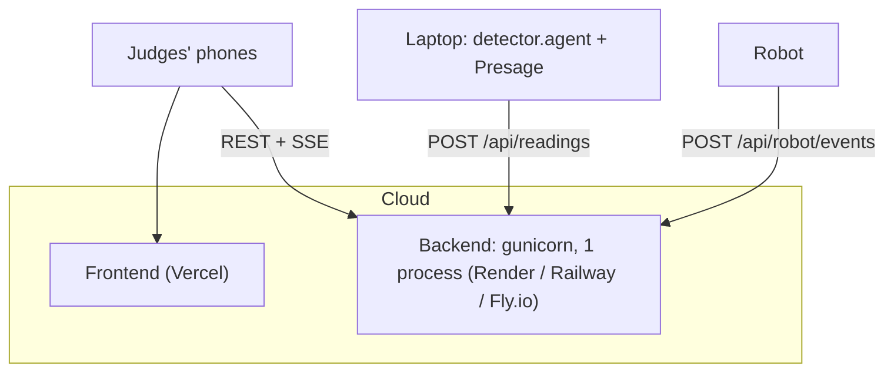
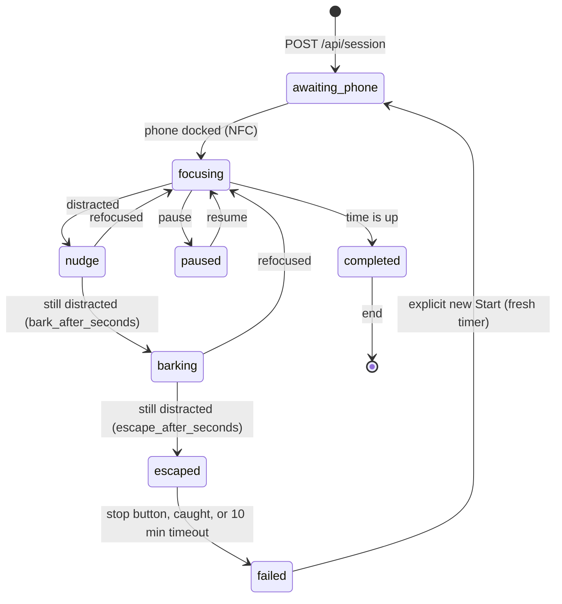

# Fido backend

Flask backend for Fido, the OxHack '26 focus robot dog. It is the single source
of truth for the focus session: every phone, laptop, camera, and the robot read
and change state through it.

The detection logic is Vayun's prototype
([`archive/oxhack26-prototype`](../archive/oxhack26-prototype), from
[vayunk/Oxhack26](https://github.com/vayunk/Oxhack26) at `9e49425`), ported
with its gaze geometry and posture calibration preserved. Face activity now
uses Presage rather than the prototype's MediaPipe jaw/blink thresholds.

> [!IMPORTANT]
> **Presage vitals come from a short 25-second scan, not a live feed.**
> The SmartSpectra SDK runs on the laptop but is **not offline**: it
> authenticates with Presage's servers and spends credits while it measures
> (about one credit per 25-30 s). So, as in the prototype,
> `presage/test_presage.mjs` does one 25-second scan (one credit) and saves
> pulse, breathing and HRV. Those numbers are a snapshot from that scan; they
> do not update during a session. The scan needs a still, front-facing face
> at 25+ fps, and in 25 s usually yields pulse only (breathing needs 30 s, HRV
> 60 s). Gaze/posture detection is local and free. **Talking/blinking and
> landmark-based eye closure now use a separate bounded Presage face scan**,
> launched automatically by the camera agent after Start. That scan may consume
> credits too; it defaults to 25 seconds and never auto-restarts.
> See [Presage face detection](#presage-face-detection) and [Presage vitals](#presage-vitals).

```
laptop / dog webcam                         phones + laptop browsers
 detector/agent.py  --POST /api/readings-->  +-----------+  <--REST + SSE /api/events--
 presage/test_presage.mjs -> vitals file    |  fido/    |
                                            |  (Flask)  |  <--POST /api/robot/events--  robot
                                            +-----------+  --reply: mode, motion------>
```

| Part | What it does |
| --- | --- |
| `fido/engine.py` | Session state machine: lock-in, sentry, heist, rescue. Pure Python, unit-tested. |
| `fido/app.py` | HTTP API, Server-Sent Events, device token. |
| `detector/focus.py` | Prototype detector: MediaPipe face geometry + YES / NO timers. |
| `detector/agent.py` | Runs the detector on a camera and reports to the backend. |
| `presage/` | Live face-metric bridge plus the preserved 25-second vitals harness. |

## Run it locally

Requires Python 3.11+ (tested on 3.13). From this directory:

```sh
python3 -m venv .venv
.venv/bin/pip install -r requirements-dev.txt -r requirements-detector.txt
(cd presage && npm ci)                 # native SmartSpectra runtime (Node.js 20.9+)
# Set SMARTSPECTRA_API_KEY in presage/.env; do not commit it.

.venv/bin/python -m fido                 # backend on http://0.0.0.0:5000
.venv/bin/python -m detector.agent       # laptop webcam -> backend (Ctrl+C to quit)
.venv/bin/python -m pytest               # tests
```

Or everything at once with a simulated robot (heartbeat; dock and good-boy
card via the printed curl commands), short escalation timings, and the
detector on the webcam or a looping video:

```sh
sh scripts/demo.sh          # webcam 0
sh scripts/demo.sh clip.mp4 # recorded video instead of a webcam
```

### Camera inside the website

On the Focus page, click **Show camera** beneath the companion and session
cards. The detector now provides its actual annotated feed inside the website
instead of opening a separate desktop window. Detection still runs in Python;
there is no second browser camera capture.

Keep all three processes running in separate terminals:

```sh
# From backend/
.venv/bin/python -m fido --port 5000

# From the repo root
NEXT_PUBLIC_FIDO_API=http://localhost:5000 PORT=3000 sh run.sh dev

# From backend/
.venv/bin/python -m detector.agent --server http://localhost:5000
```

Open http://localhost:3000. Python still needs macOS camera permission.
Hiding the preview does not stop detection; Ctrl+C in the detector terminal
stops capture.

The preview binds only to `127.0.0.1:5002`. Frames are never uploaded to Flask
or a cloud host. A phone cannot view the laptop's feed through its own
localhost. Use the local HTTP website: an HTTPS site may block this local HTTP
stream. Remote preview sharing is not implemented.

Options:
- `--window`: also open the old OpenCV desktop window.
- `--headless`: disable both browser and desktop previews.
- `--preview-port 5003`: use another preview port; restart the frontend with
  `NEXT_PUBLIC_FIDO_PREVIEW=http://localhost:5003/preview.mjpg` to match.

Preview delivery is capped at 10 fps using a latest-frame buffer, without
changing the detector's processing rate. No recording is saved.

More detector options:

```sh
.venv/bin/python -m detector.agent --source dog --camera 1                # a second USB webcam
.venv/bin/python -m detector.agent --source dog --camera http://<cam>/stream  # network camera (MJPEG/RTSP)
.venv/bin/python -m detector.agent --server https://<hosted-backend> --headless
.venv/bin/python -m detector.agent --source replay --camera clip.mp4     # loop a recording, no webcam needed
```

The agent analyses every frame the camera delivers, at the camera's full rate
(the prototype did the same), and reports the decision about 5 times a
second, or immediately when YES / NO flips. Each new session starts with a
fresh 30-frame posture calibration, so look at the screen when a session
starts. Frames never leave the machine running the agent.

With no robot yet, set `require_dock` to `false` (see Settings) so sessions
start without docking the phone.

### Presage face detection

The normal `detector.agent` command launches `presage/bridge.mjs` as a child.
Python owns the **only** camera capture and sends a downscaled BGR copy through
a bounded local pipe; the Node SDK uses `useCustomInput()` and never opens the
webcam. No additional terminal or HTTP service is needed.

```sh
# From backend/; install once, without starting a scan:
(cd presage && npm ci)
# Put SMARTSPECTRA_API_KEY in presage/.env, or export it in this terminal.
.venv/bin/python -m detector.agent --server http://localhost:5000
```

The detector can stay running while Flask is idle: no SDK process is started
until the backend reports focusing, nudge or barking after Start/docking.
It stops and destroys the SDK on pause, escape, failure, completion, session end,
or lost backend contact (failed request, or no successful reply for 3 seconds).
The camera and local posture detection continue independently.

A new session, resume, or reconnection into an active session automatically
starts a new bounded face-only scan. The default wall-clock budget is
**25 seconds per active period**, followed by stopped/unknown activity signals.
Budget exhaustion or SDK failure does not automatically restart the scan within
that same active period. Talking/eye closure remain unknown until a subsequent
active period; no jaw/blink fallback. Restarting/resuming may incur a new provider
charge; frequent pause/resume or network failures can therefore increase costs.
Flask alone does not create Presage sessions.

To deliberately allow face detection for a whole 25-minute session (may consume
substantially more credits), opt in explicitly:

```sh
.venv/bin/python -m detector.agent --server http://localhost:5000 --presage-seconds 1500
```

For free posture-only testing, use `--no-presage`; no SDK session is started.
The face scan doesn't request pulse/breathing/HRV and does not replace the
optional vitals snapshot described below.

Decision rules:

- **Talking:** native stable `face.talking` samples; at least 0.6 seconds of
  detected talking within the last 6 seconds. Short pauses don't discard the
  window. This replaces both jaw-open time and mouth-opening burst heuristics.
- **Blinking:** native stable `face.blinking`, shown as yes/no plus rising-edge
  count. A normal blink does not trigger distraction.
- **Eye closure:** derived from Presage's documented 478 pixel-coordinate face
  landmarks ([model card and numbering reference](https://smartspectra.presagetech.com/docs/model-cards-and-limitations.md)).
  Both eyes must have an eye-aspect ratio below 0.18 for 4 continuous seconds.
  This is a tunable **prolonged-closure heuristic, not a Presage sleep diagnosis**.
- Unstable, missing, stale (>1 s), duplicated, out-of-order, or pre-session
  samples cannot extend timers. Duration advances only on new SDK timestamps,
  never by repeatedly polling a held value. Opening eyes, a gap, face loss, or
  session recalibration resets continuity.
- **Anti-flicker recovery:** any focus NO takes effect immediately. Returning
  to YES requires 2 continuous seconds of clear detector readings; another NO
  restarts that countdown. The preview and backend receive this same latched
  decision. Capture stalls over 1 second do not count toward recovery, and
  session recalibration clears the latch for a fresh start.

The preview identifies Presage status, talking, blinking and eye closure; `?`
means unknown, not "not talking" or "eyes open". Auth/credit/runtime failures
leave these signals unavailable, never silently replaced with MediaPipe.

Frame timestamps are epoch-anchored once and then advanced by a monotonic
clock. Frames captured before `sdk.start()` finishes are discarded, including
ones buffered during native model/auth startup. Capture is handed to the bridge
before MediaPipe processing. Actual capture intervals are retained: no replay,
time compression, or interpolation to hide gaps. A rejected timestamp-gap frame
(code 11) is dropped without destroying the scan. Other SDK errors remain fatal
for that active period and are shown with safe code/stage diagnostics.

**Privacy and cost:** SmartSpectra computes metrics on-device, but contacts
Presage for authentication/subscription/credit checks. This bridge disables
optional SDK telemetry and does not enable LLM Insights. Frames travel only
through the in-memory local pipe and optional localhost preview, never to Flask;
no frame, landmark, or per-sample biometric files are written. Only decisions,
reasons, aggregate talking/closure durations and blink/availability counts go to
Flask's bounded in-memory latest readings (cleared on server restart). The key
stays in the environment or ignored `.env`, never command arguments or logs.

Offline tests (no camera, API key, authentication or credits):

```sh
.venv/bin/python -m pytest -q
(cd presage && npm test)
```

### Laptop audio player

`audio/player.py` plays Fido's spoken cues (`state.speech`, see
[`docs/audio.md`](../docs/audio.md)) on the laptop. It is the fallback for the
robot's Bluetooth speaker, not a second voice:

```sh
.venv/bin/python -m audio.player --server http://localhost:5000
.venv/bin/python -m audio.player --dry-run   # print and download cues, make no sound
```

- It follows `GET /api/events`, plays each cue exactly once (the highest
  `speech.seq` is remembered), and only records `seq` on its first snapshot
  after starting or reconnecting, so a restart never replays old speech.
- **Silent while `robot.online` is true and `robot.info.speaker == "connected"`**;
  otherwise it plays. Skipped cues are never replayed later.
- A new cue cuts off the clip still playing. Clips are downloaded once from
  `/api/audio/<clip>.mp3` into a temporary directory removed on exit.
- Uses a system player, no Python dependency: `afplay` (macOS, built in), else
  `ffplay` (ffmpeg, any OS), else `mpg123`. With none installed it exits with
  a message. `aplay` and `paplay` cannot play MP3, so they are not used.
- Sends `Authorization: Bearer $FIDO_DEVICE_TOKEN` when that is set. There is no
  volume option; use the system volume.

### Presage vitals

The same setup as the prototype:

```sh
cd presage
npm install
echo "SMARTSPECTRA_API_KEY=<your key>" > .env    # gitignored
npm run test-safe
```

The harness runs for 25 seconds, which uses one credit, then writes
`detector/presage_vitals.json`. The detector agent shows those vitals on its
preview and forwards them, so they appear under `vitals` in the state.
Presage is not fully local: the SDK runs on this machine, but it authenticates
and counts credits against Presage's servers, so it needs internet access.

Getting real numbers out of the 25-second scan (from testing):

- **One person, facing the camera, holding still, in good light.** The SDK
  repeats "Hold still and record." and returns nothing while the face moves.
- **At least 25 fps.** Below that it only says "Use a camera mode that provides
  at least 25 frames per second". Dim light lowers webcam fps.
- **Pulse needs about 12 s of good signal, breathing 30 s, HRV 60 s.** A
  25-second scan reliably gives pulse at best; breathing and HRV often stay
  empty (`null`, shown as `--`).
- The webcam must be free: stop `detector.agent` while the scan runs, since
  both open the same camera.

## Fido's voice (recorded clips)

Fido's voice is **six recordings of our friend Dheer, and nothing else**: no
AI-generated voice, no voice clone. The running server never generates audio.
The clips are in `clips/` (MP3, mono, 22.05 kHz, 32 kbps):

| Clip | Says |
| --- | --- |
| `dock-1` | "Ooh, a new goal! Pop your phone on my back and let's get started!" |
| `nudge-1` | "Psst... your task is waiting for you. I believe in you." |
| `bark-4` | "Woof! Woof!" |
| `bark-5` | "Woof woof woof!" |
| `run-5` | "Grrr... WOOF!" |
| `woof-1` | "Woof!" |

How they were made:

1. **Record** with `.venv/bin/python -m recorder` (see "Recording a voice
   actor" below). The plan, `fido/recording.py`, is these six takes.
2. **Process** with `.venv/bin/python scripts/process_recordings.py
   --accept-redo woof-1,woof-2,woof-3` (see "Processing the recordings").
   `--accept-redo` is needed because those woofs clip a little, by choice, and
   would otherwise get a `REDO` verdict and not be written.
3. Commit `clips/*.mp3` (and `clips/manifest.json`).

**Which clip plays when** is one table, `PLAYLIST` in `fido/speech.py`: cue ->
list of clip names. A clip may appear under several cues; a cue that is missing
or empty is silent; a cue's clips rotate in order. Current table:

| Cue | Clips |
| --- | --- |
| `dock` | `dock-1` |
| `start` | `woof-1` |
| `nudge` | `nudge-1` |
| `bark` | `bark-4`, `bark-5` |
| `run` | `run-5`, `bark-5` (repeats every `speech_repeat_seconds`) |
| `caught` | `bark-4` |
| `timeout` | `nudge-1` |
| `praise` | `woof-1` |
| `done` | `bark-5` |

To reuse clips differently, edit the table. The caption the app shows comes
from `CAPTIONS` (the words of each clip) in the same file; **a caption must
match what the clip actually says**, so update it if you replace a recording.
`GET /api/audio` lists only the clips that are in the playlist.

**Privacy.** The clips are Dheer's voice. Committing and pushing them publishes
his voice. He consented to that for this hackathon project only; the consent
record is `recordings/consent.json`. The raw takes in `recordings/` are
gitignored and are never committed.

## Optional: generated or cloned voice (not used)

> **Not used.** Fido plays only the recorded clips above. This section and
> `scripts/generate_audio.py` are kept in the repository for a possible future
> AI voice. The generator works from the full line script in `fido/speech.py`
> (`SCRIPT`), not from the playlist, so **running it would generate lines that
> are not in the playlist** (and spend credits on them). The clone steps also
> refer to the earlier, larger recording plan; the current plan is six takes.

When used, the lines and woofs would be pre-generated ElevenLabs clips (see
[`docs/audio.md`](../docs/audio.md)); the running server never calls
ElevenLabs. Only the fixed script in `fido/speech.py` is sent to ElevenLabs:
**no task text or other user input is ever sent.** Only whoever regenerates the
clips needs a key.

```sh
cp .env.example .env            # then put your key after ELEVENLABS_API_KEY= (gitignored)

.venv/bin/python scripts/generate_audio.py --dry-run          # cost only: no network, no key
.venv/bin/python scripts/generate_audio.py                    # generate the missing clips
.venv/bin/python scripts/generate_audio.py --only nudge,run --force   # redo some cues
.venv/bin/python scripts/generate_audio.py --limit 3          # try a few first
```

The key can also be exported as `ELEVENLABS_API_KEY`; it is never printed or
written to a tracked file. Output goes to `clips/`: `<clip>.mp3`, `voice.json`
(the non-secret Voice Design `voice_id`, reused on later runs so every clip has
the same voice) and `manifest.json` (name, cue, caption, bytes, duration,
sha256). Existing clips are skipped unless `--force`.

- **Voice**: created on the first run with Voice Design (a young, squeaky,
  cheeky puppy). It takes one of the 3 custom voice slots of a free plan.
  `--voice-id <id>` uses an existing voice; `--redesign` makes a new one.
  To hear candidates first and pick one, use the audition workflow below.
- **Speech lines** use `eleven_v3` (audio tags like `[whimpers]`) with low
  stability; **sound effects** (woofs, growls) use the sound-generation API at
  2.5 s each.
- **Format** is `mp3_22050_32` (smallest offered, about 4 KB per second) because
  the clips end up in the ESP32's flash; change it with `--format`.
- **Cost** for the whole library, from `--dry-run` on an empty `clips/`:
  1,802 characters of speech plus 3 sound effects, about **2,100 credits** for
  the clips, plus about **180** once for the voice preview (about 2,280 in
  total). Credits are an estimate (about 1 per character, 40 per second of
  effect); check your plan's balance. Regenerating one cue costs a few hundred
  at most.
- A 429 or 5xx is retried once; a failed clip never leaves a partial file, and
  already-finished clips are kept.

### Cloning Dheer's voice (recorded barks and lines)

The preferred voice is an **Instant Voice Clone** of our friend Dheer, so the
~21 lines we do not record can be generated in his dog voice. The takes and the
woofs are real recordings; only the rest is generated.

1. **Record** with the recorder app (`backend/recorder/`). It writes
   `recordings/consent.json` (his name and `agreed_at`) and the takes.
2. **Process**: `.venv/bin/python scripts/process_recordings.py` cleans the takes
   into `clips/` (final clips, `clips/ingredients/<woof>.mp3`) and
   `recordings/clone-samples/*.wav`.
3. **Clone**: `.venv/bin/python scripts/generate_audio.py --clone --dry-run` lists
   the samples, their total length and size (no network, no key); then drop
   `--dry-run`. It posts the samples to `POST /v1/voices/add` and writes
   `clips/voice.json` (`voice_id`, `source: "instant-voice-clone"`, sample names,
   the consent name and date; not a secret). Options: `--clone-name` (default
   "Fido (Dheer)") and `--remove-background-noise` (off by default: on clean
   samples it can make the clone worse).
4. **Try** `generate_audio.py --limit 3`, listen, then run it without `--limit`.

- **Consent**: `--clone` refuses to run unless `recordings/consent.json` has
  `agreed_at`. His recordings are sent to ElevenLabs only by this command.
- **Plan**: Instant Voice Cloning needs a **paid ElevenLabs plan** (our MLH
  Creator code includes it) and uses a voice slot. ElevenLabs recommends 1 to
  2 minutes of clean audio (under 3), each file at least 5 s; the command warns
  below 60 s and fails on an empty folder. If `clone-samples/` is missing it
  uses `recordings/<slot>/final.wav` of the takes meant for the clone.
- **Model and settings**: when `voice.json` says `instant-voice-clone`, speech
  uses `eleven_v4` (documented as the best for Instant Voice Clones and for audio
  tags) with stability 0.5, similarity 0.8, style 0, speaker boost on. Otherwise
  `eleven_v3` with stability 0. Override the model with `--model`.
- **Recorded barks**: when `clips/ingredients/<name>.mp3` exists for a line's
  bark (`fido.speech.RECORDED_BARKS`), the line is that recording joined to the
  speech with ffmpeg; no sound-effects call, and its 100-credit estimate drops
  (the dry run says `speech + recorded bark`). Missing ingredients still use
  generated barks. `bark-4`, `bark-5` and `run-5` are recorded directly as final
  clips; they are skipped when they exist.
- **Never overwrite recordings**: clips written by this script get
  `"source": "generated"` in `clips/manifest.json`; the recording script writes
  `"source": "recorded"`. Recorded clips are skipped even with `--force` unless
  you also pass `--overwrite-recorded`. Other manifest entries and keys are kept
  when the manifest is rewritten.

### Choosing the voice by ear (audition)

Voice Design returns several previews per request, and you only pay for the
preview text, so you can listen before committing credits and a voice slot:

```sh
.venv/bin/python scripts/generate_audio.py --audition --dry-run   # cost only
.venv/bin/python scripts/generate_audio.py --audition             # 1. design candidates
afplay clips/auditions/bulldog-1.mp3                              # 2. listen (macOS; any player works)
.venv/bin/python scripts/generate_audio.py --choose <generated_voice_id>   # 3. save the one you like
.venv/bin/python scripts/generate_audio.py --force                # 4. regenerate the clips with it
```

- `--audition` calls `POST /v1/text-to-voice/design` once for each description
  in `AUDITION_DESCRIPTIONS` (a cartoon bulldog, a goofy golden retriever, an
  old sheepdog; all deep) with the same preview text, and saves **every**
  returned preview as `clips/auditions/<candidate>-<n>.mp3`. `index.json` there
  lists each file with its description and `generated_voice_id`. It saves no
  voice (no slot used) and never touches `voice.json`. The folder is
  gitignored. A new audition replaces the previous one.
- `--choose <generated_voice_id>` checks the id is in `index.json`, saves it with
  `POST /v1/text-to-voice` (name `Fido`, a slot on a free plan) and writes its
  `voice_id` to `clips/voice.json`, replacing the old one. Existing clips keep
  the old voice until regenerated with `--force` (about 2,100 credits).
- **Cost**: the preview text length per design request (177 characters, so about 177 credits), so
  about 531 credits for the three candidates, however many previews each
  returns. `--choose` costs no credits. Both take `--dry-run` (no network, no
  key).
- **Previews are temporary.** ElevenLabs' docs do not say how long a
  `generated_voice_id` stays valid, so choose soon after auditioning; if
  `--choose` fails because it is gone, run `--audition` again (it makes
  different voices, so listen again).

## Recording a voice actor

A small local studio for recording Fido's voice (the plan is `fido/recording.py`). From `backend/`:

```bash
.venv/bin/python -m recorder          # opens http://127.0.0.1:5100/ ; --port N to change
```

The page asks for the performer's name and consent first (saved to `recordings/consent.json`; the server refuses uploads without it), then walks through each take with a count-in, level meter, playback, redo and keep. It gives gentle hints (too quiet, clipping, too long or short, noisy room) but never blocks.

Tips: a quiet room, phone 15 cm from the mouth or a headset mic, no speakers playing. Allow microphone access when the browser asks (Safari: Settings → Websites → Microphone; Chrome: the icon left of the address bar).

Files go to `recordings/<slot>/take-<n>.wav` (earlier takes are never overwritten), the chosen one is copied to `recordings/<slot>/final.wav`, and a 1 s room sample to `recordings/_room-tone.wav`. WAVs are encoded in the browser, so no ffmpeg is needed. Afterwards run `scripts/process_recordings.py` (see "Fido's voice (recorded clips)" above).

Privacy: the server binds only to `127.0.0.1`, rejects cross-origin requests, has no analytics and uploads nothing. `recordings/` is gitignored and its raw takes are never committed. The recordings stay on the computer unless someone runs the optional, unused voice-clone command.


## Processing the recordings

Dheer's raw takes (`recordings/<slot>/final.wav`, the six in `fido/recording.py`) become
the finished clips the app and firmware play directly. No AI and no network;
needs `ffmpeg` (`brew install ffmpeg`). `recordings/consent.json` must contain
`agreed_at`, otherwise the script refuses to run.

```sh
.venv/bin/python scripts/process_recordings.py --check    # validate only, writes nothing
.venv/bin/python scripts/process_recordings.py            # clean, encode, write clips + manifest
.venv/bin/python scripts/process_recordings.py --only woof-1,dock-1 --force
.venv/bin/python scripts/process_recordings.py --accept-redo woof-1,woof-2,woof-3   # what we ran
```

`--accept-redo SLOTS` (comma-separated take names) processes takes whose
verdict is `REDO` anyway, because you listened and accept them on purpose. We
use it for the woofs, which clip a little by choice. An unknown slot name is an
error. Do not use it for a take you have not listened to.

Other options: `--dry-run`, `--denoise` (gentle `afftdn`, off by default because
it makes voices watery), `--recordings-dir`, `--clips-dir`. Takes without a
`final.wav` are skipped, nothing is ever deleted, and outputs newer than
`final.wav` are skipped unless `--force`.

Per take: high-pass at 70 Hz, trim silence (keeps 80 ms before and 200 ms after),
two-pass EBU R128 loudness (spoken lines -16 LUFS, dog sounds -14 LUFS, true peak
-1.5 dB), 10 ms fade-in and 60 ms fade-out, then mono 22.05 kHz 32 kbps CBR MP3
with no ID3 header (same as `generate_audio.py`). Output goes to
`clips/<clip>.mp3` (plus `clips/ingredients/<name>.mp3` for takes that define an
ingredient); `clips/manifest.json` is updated and recorded clips get
`"source": "recorded"`.

The report gives each take a verdict. Warnings are advice (exit code 0); a `REDO`
take is not written unless listed in `--accept-redo`. How to fix:

- *too quiet*: speak closer to the microphone or raise the input level.
- *clipping*: lower the input level or back off; clipping cannot be repaired.
- *noisy room* / *clips in the room*: record somewhere quieter, away from fans and hard walls; `--denoise` can help a little.
- *no speech detected*: the file is silent or only noise; check the microphone and record again.
- *short* / *long*: the take differs from the expected length; check it was not cut off, or trim and re-record.

## Deploy

Not deployed yet; this is the plan. Only the Flask server is hosted. The
detector agent and Presage stay on the laptop next to the camera and talk to
the hosted URL.



Why one always-on process: the session lives in memory and browsers hold
long-lived SSE connections. **Vercel's Python functions do not fit**: they
are stateless and short-lived, so state is lost between requests and SSE
streams are cut off. The frontend can stay on Vercel.

`requirements.txt` holds only Flask and gunicorn; camera and ML dependencies
are in `requirements-detector.txt` and are not installed on the server.

### Steps (any of Render, Railway, Fly.io; Render shown)

1. **Create the service.** New Web Service from the GitHub repo, branch
   with the backend merged.
   - Root directory: `backend`
   - Build command: `pip install -r requirements.txt`
   - Start command: `gunicorn -c gunicorn.conf.py fido.wsgi:app` (same as the
     Procfile; Railway picks the Procfile up automatically)
   - Instance: the smallest always-on plan. Free tiers that sleep when idle
     add a cold start of up to a minute and drop the session.
   - Exactly **one instance**: do not enable autoscaling or multiple workers,
     or each instance will hold a different session.
2. **Set environment variables** (table below). Generate the device token with
   `python3 -c "import secrets; print(secrets.token_urlsafe(24))"`.
3. **Check it**: `curl https://<backend>/api/health` returns `{"ok":true}`, and
   `curl -N https://<backend>/api/events` prints a `state` event right away
   (if it hangs, the host is buffering SSE; the app already sends
   `X-Accel-Buffering: no`).
4. **Point the frontend at it**: set `NEXT_PUBLIC_FIDO_API=https://<backend>`
   in the Vercel project and redeploy. Set `FIDO_CORS_ORIGIN` on the backend
   to the Vercel URL.
5. **Point the laptop at it**:
   `FIDO_DEVICE_TOKEN=<token> .venv/bin/python -m detector.agent --server https://<backend>`.
   The robot sends the same token in `Authorization: Bearer <token>`.

The frontend on HTTPS cannot call a plain-HTTP backend (mixed content), so
the hosted backend must be HTTPS. All three hosts provide HTTPS by default.

Environment variables:

| Variable | Default | Purpose |
| --- | --- | --- |
| `PORT` | `5000` | Listen port (set by most hosts). |
| `FIDO_DEVICE_TOKEN` | unset | If set, the robot and detector agents must send `Authorization: Bearer <token>`. Set it on any public deployment. |
| `FIDO_CORS_ORIGIN` | `*` | Allowed browser origin, e.g. the frontend's Vercel URL. |
| `FIDO_THREADS` | `64` | Concurrent requests and open SSE streams. |

State is not persisted: a restart clears the current session and history.
See [Database](#database).

## How a session works



- **Distracted** means any live, calibrated camera says NO (the prototype's
  rules: looking at the phone or lap, looking up or away, eyes closed for 4 s,
  repeated mouth-opening bursts or sustained mouth-open activity, no face),
  or the phone left the dock.
- **Escaped** keeps running even if the user refocuses. It ends only when the
  user catches the dog and presses its stop button (the app's **Stop Fido**
  button sends the same `caught` event), or after `escape_timeout_seconds`
  (10 minutes). The stopped session is `failed`, archived as incomplete, and
  the robot rests. Only an explicit new Start begins watching again, with a
  fresh session ID, full timer, and reset distraction/escape counters.
- Pausing is allowed until the dog escapes; it stops the clock and escalation.
- The session clock starts when the phone is docked and runs in focusing,
  nudge, and barking. Escape freezes it: running away cannot earn a successful
  timer completion.
- Face activity uses the [Presage face rules](#presage-face-detection), not
  microphone audio or MediaPipe jaw/blink blendshapes. Only stable, fresh SDK
  samples contribute. Missing Presage data is explicitly unknown.

## API

All bodies are JSON. Errors are `{"error": "..."}` with status 400 (bad input)
or 409 (does not apply now; also includes the current `state`, so the client
can resync).

### App (browsers)

| Method | Path | Body | Returns |
| --- | --- | --- | --- |
| GET | `/api/state` | | State snapshot |
| GET | `/api/events` | | SSE stream: one `state` event now and one per change |
| POST | `/api/session` | `{"task": str}` (always 25 minutes) | 201 + state |
| POST | `/api/session/pause` / `resume` / `caught` / `end` | | State |
| GET / PATCH | `/api/settings` | partial settings | Settings |
| GET | `/api/history` | | Sessions, newest first |
| GET | `/api/health` | | `{"ok": true}` |

Use `/api/events` with the browser's `EventSource` and render whatever the
latest snapshot says; do not run a separate state machine or timer in the
frontend. For a countdown between events, use `remaining_seconds` and
`clock_running`.

Session duration is fixed at 25 minutes, including after a failed session.
For compatibility, `duration_minutes: 25` is accepted; any other value returns
400. Escalation timings in Settings are independent of the session duration.

State snapshot (abridged):

```json
{
  "version": 42,
  "server_time": 1792881320.5,
  "phase": "nudge",
  "session": {
    "id": "3f9c0a1b2c4d", "task": "Ship the backend", "phase": "nudge",
    "reason": "Looking Down at Phone/Lap (ΔPitch: +0.31) [laptop]",
    "duration_seconds": 1500, "remaining_seconds": 1312.4, "clock_running": true,
    "distractions": 2, "escapes": 0, "grace_until": 0,
    "phase_since": 1792881318.1, "created_at": 1792881100.0,
    "events": [{"at": 1792881318.1, "phase": "nudge", "message": "..."}]
  },
  "robot": {"mode": "nudge", "online": true, "phone_docked": true, "last_seen": 1792881320.0, "info": {}},
  "detector": {
    "focused": false,
    "sources": {"laptop": {"focused": false, "calibrated": true, "reason": "...", "fps": 29.8, "fresh": true, "timers": {"slacking": 8.2, "eyes_closed": 0, "talking": 0}}}
  },
  "vitals": {"pulse": 72, "breathing": 14, "hrvRmssd": 41.2},
  "settings": {"bark_after_seconds": 6, "...": "..."}
}
```

`phase` is one of `idle`, `awaiting_phone`, `focusing`, `nudge`, `barking`,
`escaped`, `paused`, `completed`, `failed`. `session` is `null` when idle.
`detector.focused` is `null` until a calibrated camera is reporting.

### Settings

| Setting | Default | Meaning |
| --- | --- | --- |
| `bark_after_seconds` | 6 | Distracted time in nudge before barking |
| `escape_after_seconds` | 8 | Distracted time in barking before escaping |
| `escape_timeout_seconds` | 600 | An uncaught escape stops by itself |
| `recover_grace_seconds` | 15 | No escalation after resume |
| `source_stale_seconds` | 3 | A camera silent this long is ignored |
| `robot_offline_seconds` | 5 | Robot shown offline after this silence |
| `require_dock` | true | Sessions wait for the phone; removing it is a distraction |
| `motion_enabled` | true | Robot may drive. Turn off to keep Fido still, e.g. as an emergency stop from the app |

The nudge itself starts once a camera says NO, which already takes the
prototype's 8 s of continuous slacking, or 4 s of continuous Presage-landmark
eye closure, or 0.6 s of stable Presage talking in the last 6 s.
Decision thresholds live in `DetectorConfig`; sample/window handling is in
`detector/presage.py`.

### Devices

If `FIDO_DEVICE_TOKEN` is set, send `Authorization: Bearer <token>`.

| Method | Path | Body | Returns |
| --- | --- | --- | --- |
| POST | `/api/readings` | `{"source": "laptop", "reading": {"focused", "calibrated", "reason", "fps"?, "timers"?}, "vitals"?}` | `{"phase", "calibration_id"}` |
| POST | `/api/robot/events` | `{"event": "heartbeat" \| "docked" \| "undocked" \| "caught", "info"?: {}}` | Robot command |
| GET | `/api/robot/command` | | Robot command |

Robot command:

```json
{"mode": "bark", "motion_enabled": true, "task": "Ship the backend", "remaining_seconds": 1312.4, "reason": "...", "version": 42}
```

`mode` is `sleep`, `beckon_dock` (show "place your phone" on the OLED),
`watch`, `nudge`, `bark`, `run`, `rest`, or `celebrate`.

The robot contract is deliberately hardware-neutral, since the board may change
(ESP32, Arduino Uno Q, or Raspberry Pi). Any board that can make HTTPS
requests fits:

- POST a `heartbeat` about every second; the reply is the command. Optional
  `info` is shown in the app; known keys: `battery` (percent, 0-100) and
  `board` (e.g. `esp32`). Send
  `docked` / `undocked` when the NFC tag on the phone appears or disappears,
  and `caught` when the stop button is pressed after catching Fido (an existing
  good-boy card can send the same event). No firmware is implemented here.
- **Stop the motors** whenever `motion_enabled` is false, and whenever no reply
  has arrived for 3 seconds. The `run` routine (drive off the table, land, run)
  should have its own maximum duration on the robot.

## Design decisions

### Live updates: SSE + REST

| Option | Pros | Cons |
| --- | --- | --- |
| **REST + SSE (chosen)** | Plain HTTP: works through any host, proxy, or CDN, and in every browser via `EventSource` with auto-reconnect. One-way push is all clients need; commands are ordinary REST calls. No extra libraries. | One thread per open stream; one-way only. |
| WebSockets (flask-sock) | Two-way, low latency. | Needs a WebSocket-capable host and server setup; reconnect logic is ours to write. Two-way is not needed. |
| Socket.IO | Rooms, reconnects, fallbacks. | Heavy protocol; needs a matching client library on every device, including the robot. |
| REST polling only | Simplest possible. | Laggy or wasteful: 1 s polling means up to 1 s delay on every phone, and the rubric weights speed at 30%. |

Devices use plain REST: the robot's heartbeat doubles as its command poll, so
any board with an HTTP client can join, with no persistent connection to
manage.

### Database

None yet. The only state is one live session plus a short history list, held
in memory by one process; a database would add a dependency and setup without
changing the demo. It becomes worthwhile for: history that survives restarts,
more than one dog or user, or analysing distraction data over time. TigerData
(Postgres + TimescaleDB) fits that last case well and is a sponsor track:
readings and session events are already time-series, and `FocusEngine.history`
and the per-session `events` are the natural tables.

### Detection stays next to the camera

The detector agent runs where the camera is, and only YES / NO decisions travel
over the network. Sending video to a hosted backend would be slower, use far
more bandwidth, and send faces to the cloud. It also keeps the hosted server
small: MediaPipe and OpenCV are not installed there.

## Later

- **AI voice**: the team chose recorded clips only. A generated or cloned
  voice (ElevenLabs, see "Optional: generated or cloned voice (not used)")
  would be a new decision.
- **Robot code**: on hold until the board is chosen (ESP32 / Uno Q / Pi).
- **Persistence / TigerData**: see Database.
- **Continuous Presage vitals**: the harness is a 25-second, one-credit run, as
  in the prototype. Running it for whole sessions would cost one credit per
  ~25-30 s.
