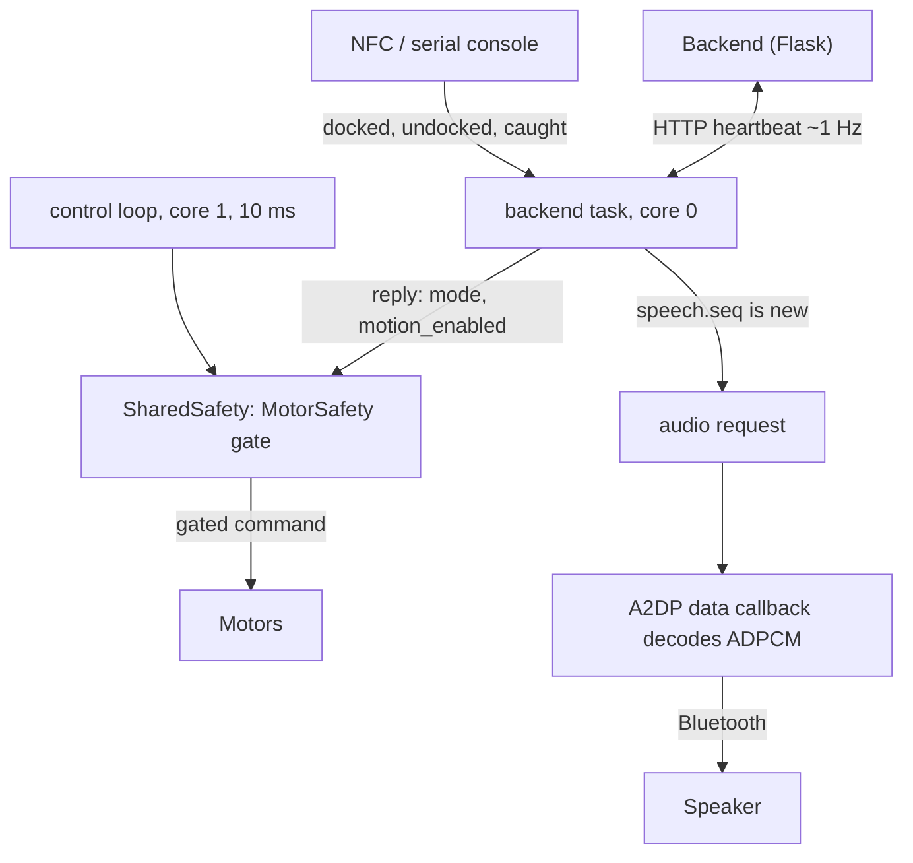

# Fido robot firmware

PlatformIO project for the robot's **ESP32-DevKit-V1** (DOIT, ESP32-WROOM-32, 4 MB flash). The robot is a
hardware-neutral client of the Flask backend (`../backend`): it POSTs a heartbeat to `/api/robot/events` about once
a second, obeys the reply (`mode`, `motion_enabled`, `speech`), and plays the dog's voice clips on a Bluetooth
speaker.

> [!WARNING]
> **The robot can drive off a table.** Motion is compiled out by default (`ENABLE_MOTION 0`): with the default config
> no code path can drive a motor pin. Do the [bench-test checklist](#bench-test-checklist-motors-disabled-wheels-off-the-ground)
> before you even think about [enabling motion](#enabling-motion).

> **Only the original ESP32 (WROOM-32) works.** The ESP32-S3 and C3 have no Classic Bluetooth, so no A2DP audio.

## Layout

| Path | What |
| --- | --- |
| `platformio.ini` | `esp32dev` (firmware) and `native` (host unit tests) environments, pinned versions |
| `partitions.csv` | 4 MB map: 2.4 MB app, **1.5 MB `audio`**, no OTA |
| `include/config.example.h` | Copy to `include/fido_config.h` and edit (gitignored: Wi-Fi password, token) |
| `src/` | Arduino-side code: `main.cpp`, `backend_client`, `mode_controller`, `motors`, `audio`, `console`, `nfc`, `display` |
| `lib/fido_core/src/` | **Pure C++, no Arduino calls**, unit-tested on the laptop: `motor_safety`, `motion_planner`, `command` (reply parsing), `speech_gate`, `adpcm`, `clip_store`, `clip_player`, `backoff` |
| `test/` | Unity tests for `fido_core` (`pio test -e native`) |
| `tools/prepare_clips.py` | `backend/clips/*.mp3` -> `build/clips.bin` (IMA ADPCM) |
| `tools/uploadaudio.py` | `pio run -t uploadaudio` flashes that blob to the `audio` partition |

## Build and flash

PlatformIO is installed in a throwaway venv (nothing global):

```sh
python3 -m venv .pio-venv && .pio-venv/bin/pip install platformio     # from the repo root; .pio-venv/ is gitignored
export PATH="$PWD/.pio-venv/bin:$PATH"

cp firmware/include/config.example.h firmware/include/fido_config.h    # then edit: Wi-Fi, backend URL, token, speaker name
pio test -d firmware -e native          # safety/protocol/audio unit tests, no hardware needed
pio run -d firmware                     # compile (first run downloads ~hundreds of MB of toolchain)

python3 firmware/tools/prepare_clips.py # needs ffmpeg; builds firmware/build/clips.bin from backend/clips/*.mp3
pio run -d firmware -t upload           # flash the program (USB)
pio run -d firmware -t uploadaudio      # flash the clips to the audio partition (once, and whenever clips change)
pio device monitor -d firmware          # serial console, 115200 baud
```

The first flash also writes the partition table. Without the clips the robot still works, but leaves audio to the
existing laptop player (`[audio] audio partition is empty` in the log). The build prints a warning and falls back to the placeholders if
`fido_config.h` is missing; it will not connect to anything useful.

The backend must be reachable from the robot's Wi-Fi (2.4 GHz only): `python -m fido` listens on `0.0.0.0:5000`; use the
laptop's LAN IP in `BACKEND_BASE_URL` and set the same `FIDO_DEVICE_TOKEN` as `DEVICE_TOKEN`.
macOS AirPlay occupies port 5000; use `--port 5001` and adjust the URL.

## Serial test commands

Open the monitor and type a single key (no Enter) to simulate the NFC layer, which has no reader yet:

| Key | Does |
| --- | --- |
| `d` | send `docked` (phone placed on the dog) |
| `u` | send `undocked` (phone lifted off) |
| `c` | send `caught` (good-boy card; only counts during an escape) |
| `x` | **emergency stop**, latched until `r` |
| `r` | release the stop |
| `s` | print status now (also printed every 5 s) |
| `p`, then a clip name, Enter | play a clip immediately, e.g. `nudge-1` |
| `l` | list the clips found in flash |
| `h` | help |

Status line, for stress tests:

```
[status] up 93s | wifi up rssi -54 | backend ok 90 dropped 1 last 38ms avg 41ms max 212ms code 200 | mode watch motion_enabled 1 |
motion compiled-out | speaker connected (playing) | clips 25 played 3 dropped 0 unknown 0 | heap 171000 min 160000
```

`dropped` counts failed heartbeats (timeout, Wi-Fi down, bad status, bad JSON); `avg`/`max` are request latency; `heap`
and `min` show free and lowest-ever-free memory; `[a2dp]` lines log connect/disconnect/retry.

## Wiring (PLACEHOLDERS)

> [!IMPORTANT]
> The motor driver, OLED and NFC reader models are **not confirmed**. Everything below is a placeholder in
> `config.example.h`. Check every pin against your wiring before powering the motors.

| Function | Default GPIO | Notes |
| --- | --- | --- |
| Left motor PWM / EN | 25 | L298N `ENA`, TB6612 `PWMA` |
| Left motor dir 1 / 2 | 26 / 27 | `IN1`/`IN2` or `AIN1`/`AIN2` |
| Right motor PWM / EN | 33 | `ENB` / `PWMB` |
| Right motor dir 1 / 2 | 32 / 13 | `IN3`/`IN4` or `BIN1`/`BIN2` |
| Driver standby | none (`-1`) | TB6612 `STBY`; set `MOTOR_STBY_PIN` or tie it high |
| Battery sense | none (`-1`) | ADC1 pin (GPIO 32-39) behind a divider; ADC2 does not work with Wi-Fi |
| OLED | none | stubbed: `SerialDisplay` logs to serial. Replace `Display` when the model is known |
| NFC reader | none | stubbed: `SerialNfc` (serial keys). Replace `Nfc` when the model is known |
| Speaker | n/a | Bluetooth A2DP, no wiring |

* Pins are from GPIOs that are safe at boot (not 0, 2, 5, 12, 15 strapping pins, nor 6-11 flash). GPIO 32/33 are on ADC1:
  move the motor to other pins if you add battery sensing there.
* **Fit ~10 kΩ pull-down resistors** from each PWM and direction input of the motor driver to GND. After a reset or
  while flashing, ESP32 pins float; the pull-downs make that mean "stopped".
* Power the motors from their own supply (shared ground), not from the ESP32's 3.3 V/USB. Brown-outs from motor
  current resetting the ESP32 are likely; add bulk capacitance near the driver.
* Differential drive: two rear wheels driven, passive omni wheel in front. If a wheel spins backwards for
  "forward", flip `MOTOR_LEFT_INVERT` / `MOTOR_RIGHT_INVERT`.

## How it works



* **Backend client** (`backend_client.cpp`): own FreeRTOS task on core 0. Sends `{"event":"heartbeat","info":{"board":
  "esp32-devkit-v1","battery":..,"speaker":"connected|disconnected|none"}}` (battery omitted without a sensor) and
  `Authorization: Bearer <token>` when configured. NFC events go out immediately as their own POST. Timeouts: 0.8 s
  connect, 1.2 s total, so one bad request cannot stall the task for long.
* **Mode controller** (`mode_controller.cpp`): `sleep`, `beckon_dock`, `watch`, `nudge`, `bark`, `run`, `rest`,
  `celebrate` -> a display line (serial for now) and motor intent. `nudge` is a tiny in-place wiggle (100 ms, 200 ms,
  100 ms pulses, wheels opposing, no net travel, every 1.5 s). `run` drives forward with a gentle weave. All other
  modes stand still. An unknown mode string is treated as "stand still".
* **Motor safety** (`lib/fido_core/src/motor_safety.cpp`): see below.
* **Audio**: see [Audio](#audio).

### Motor safety rules

Every motor command passes through `MotorSafety::gate()`. The output is zero when any of these hold:

1. software e-stop latched (`x` on serial);
2. no successful backend reply since boot;
3. last successful reply older than **3 s** (watchdog; it keeps working even if the backend task hangs, because the
   control loop just compares timestamps);
4. **2 consecutive failed requests** (HTTP error, timeout, Wi-Fi down, unparseable body);
5. latest reply has `motion_enabled` not literally `true`;
6. mode is not `run` or `nudge`; the instant the mode changes (user caught the dog) the motors stop;
7. `run` has lasted **`MAX_ESCAPE_MS`** (default 8 s), even if the backend still says `run`; the timer restarts only
   after the mode leaves `run`;
8. `ENABLE_MOTION` is 0 (checked last, so with motion compiled out the log shows
   `would be moving in mode run` when the other rules would have allowed it).

Speed is capped at `MAX_SPEED_PERCENT` (35 %, build-time maximum 60 %) for `run` and `WIGGLE_SPEED_PERCENT` (25 %) for
`nudge`. Motor pins are driven to the stopped state first thing in `setup()`. A 5 s task watchdog resets the chip if the
control loop hangs (see the pull-down note above). The rules are exercised by 16 host tests
(`test/test_safety`), including millis() rollover, NaN/out-of-range intents and a fresh timer per escape.

## Audio

### Format decision: MP3 -> IMA ADPCM, converted on the laptop

The A2DP *source* library (`ESP32-A2DP`) pulls **44.1 kHz, 16-bit, stereo PCM** from a data callback and SBC-encodes it
itself (stated in its README; the only supported codec is SBC). The clips are MP3s of recorded dog sounds and two spoken lines.

| Option | Verdict |
| --- | --- |
| Decode MP3 on the ESP32 | needs a decoder library (minimp3/Helix), 10-20 KB RAM, real CPU per frame next to Wi-Fi and Bluetooth. More moving parts, nothing gained: the clips are fixed. |
| Store raw PCM | 16 kHz mono 16-bit is 32 KB/s: about 4 MB for 121 s of audio (an earlier, larger clip set). Does not fit. |
| **Store IMA ADPCM (chosen)** | 4 bits/sample: 16 kHz mono = 8 KB/s. The decoder is ~20 lines of integer maths, no RAM beyond a few ints. |

`tools/prepare_clips.py` decodes every MP3 with ffmpeg to mono 16 kHz (adds a 100 Hz high-pass for small speakers and
peak-limits), encodes ADPCM, and writes one blob with a small clip table. On the ESP32 the A2DP callback reads the
blob straight from the memory-mapped `audio` partition, decodes, duplicates mono to stereo and upsamples 16 -> 44.1 kHz by
linear interpolation. Decoding is only ~16k samples/s, trivial for the CPU. The Python encoder and the C++ decoder agree
bit for bit (a golden vector is a unit test). When no clip is playing, the callback returns 0 bytes, so no audio is
sent (and no radio time is used).

**Size math.** Flash is 4 MB (`0x400000`). `partitions.csv`: nvs 20 KB, phy 4 KB, app **2432 KB**, audio **1536 KB**
(`0x270000-0x3F0000`), coredump 64 KB. The compiled firmware is 1.56 MB, so the app has 0.87 MB spare.
The flash blob holds whatever is in `backend/clips/*.mp3`, converted by
`firmware/tools/prepare_clips.py`. That is now only the six recorded clips
(`dock-1`, `nudge-1`, `bark-4`, `bark-5`, `run-5`, `woof-1`), a few seconds in
total. In general, 16 kHz ADPCM is 8000 B/s (16,000 samples/s x 4 bits), so:

* **Real case:** roughly 18 s x 8000 B/s = **about 150 KB, roughly 10 % of the
  1536 KB partition**. Far below the limit. (An estimate; the tool prints the
  exact clip count, seconds and bytes.)
* **General case:** the partition holds about 1536 KB / 8000 B/s = 190 s at
  16 kHz. An earlier 31-clip generated set (about 121 s, 0.97 MB, 62 %) would
  also have fitted.
* At 22.05 kHz the same audio would take about 1.4x as much; speech through a
  small speaker gains little, so 16 kHz stays.
* If a larger set ever does not fit, the script keeps clips in cue priority order (`run`, `bark`, `nudge`, `caught`, `start`, `dock`,
  `praise`, `done`, `timeout`) and reports what it left out; `--rate` and `--gain-db` are options.

Unknown clip names are ignored (and counted). The heartbeat's `speaker` reports **playback availability**, not just
the Bluetooth link:

* `none`: Bluetooth has not started, or the audio partition is missing, unmappable, invalid, or lacks any nonempty
  required runtime clip (`dock-1`, `woof-1`, `nudge-1`, `bark-4`, `bark-5`, `run-5`).
* `disconnected`: the image contains all required clips, but Bluetooth is disconnected.
* `connected`: all required clips are available **and** Bluetooth is connected.

The required IDs in `lib/fido_core/src/speaker_status.h` must stay in sync with `backend/fido/speech.py`'s `PLAYABLE`.
Extra clips are allowed; a valid partial image is not ready. A zero-sample required clip is not ready either.
The existing laptop player suppresses new cues only for an online robot reporting `connected`, so `none` and
`disconnected` preserve fallback. Run that player for laptop audio; the firmware does not launch it.
`[a2dp]` connect/disconnect/retry logs and the connection counters still describe the actual Bluetooth link, even
when playback status is `none`. This readiness check is not an acknowledgement that an individual cue was heard.

### Playing each cue once

The reply's `speech.seq` goes through `SpeechGate`: the first reply after boot (or after a backend outage of 2+ failed
requests) only records `seq`; later replies play only when `seq` is greater; a `seq` that goes down (backend restart)
is recorded without playing. If the speaker is not connected the cue is skipped, not queued: the laptop is playing it
(`docs/audio.md`).

## Wi-Fi + Bluetooth coexistence

Wi-Fi and Bluetooth share one 2.4 GHz radio.

* The SDK's software coexistence arbiter is on (`CONFIG_SW_COEXIST_ENABLE`; the build fails if it is not).
* Wi-Fi modem power save is on (`WIFI_POWER_SAVE 1`), which leaves air time for A2DP between beacons. Cost: roughly up
  to 100 ms extra per request, far inside the 3 s watchdog.
* The backend task runs on core 0, the control loop and the A2DP app task on core 1. The A2DP data callback only decodes
  from flash and never blocks or touches the network.
* HTTP requests are short (0.8 s connect, 1.2 s total timeouts, no keep-alive) and the heartbeat does not wait for
  audio, so it keeps beating during playback. The control loop never waits on the network.
* The safety watchdog is independent of audio state.
* Speaker reconnect: the library connects by name ~10 s after boot, then retries every 10 s on its own. This firmware
  stretches that with backoff (10, 20, 40, 80, then every 120 s) so a switched-off speaker does not keep stealing radio
  time, and it never blocks the control loop or Wi-Fi. With a complete audio image, `speaker` in the heartbeat is
  `disconnected` until it connects (otherwise `none`), so the laptop covers the audio. Put the speaker in pairing mode the first time; afterwards it reconnects to the last
  address (stored in NVS).

## Bench-test checklist (motors disabled, wheels off the ground)

Keep `ENABLE_MOTION 0` for all of this. With motion compiled out, no code can drive a motor pin.

1. **Unit tests:** `pio test -d firmware -e native` is green.
2. **Config:** `fido_config.h` has your Wi-Fi, backend URL and token; the build shows no `config.example.h` warning.
3. **Power:** USB only, **motor battery disconnected**, wheels in the air anyway.
4. **Boot:** the monitor shows `motion compiled out`, then `[wifi]` connect, then `[mode] sleep` (backend with no session).
5. **Heartbeat:** `s` shows `backend ok` rising about once a second, `dropped 0`, `avg` well under 200 ms. In the app
   the robot shows online with `board esp32-devkit-v1` and the speaker state.
6. **Modes follow the app:** start a session. Watch the monitor: `beckon_dock`, `watch`, then `nudge`, `bark`, `run` as
   you slack off. The log shows `[motor] (ENABLE_MOTION=0) would be moving in mode run`.
7. **Simulated NFC:** `d` / `u` / `c` appear in the backend session log. `c` ends an escape.
8. **Watchdog:** stop the backend (Ctrl+C) during `run`; `[backend] ... failed` appears, then `stopped (http-errors)`
   within 2 s, and in the log `would be moving` stops.
9. **Audio:** pair the speaker; `[a2dp] speaker connected`. `p` then `nudge-1`: it plays. Trigger a nudge from the app: it plays
   once, not twice. Keep a heartbeat watching (`s`) while a clip plays: `dropped` must not climb, and no stutter.
   With a missing/invalid/incomplete image, Bluetooth may still log connected, but heartbeat `speaker` must be `none`
   and the running laptop player must play new cues. With a complete image and Bluetooth connected, heartbeat
   `speaker` must be `connected` and only the robot should play. These require a separate safe bench test; host tests
   cover the readiness rule, not actual sound or Bluetooth.
10. **Reconnect:** switch the speaker off and on; the log shows disconnect, backed-off retries and a reconnect, and the
    heartbeat shows `speaker disconnected` meanwhile and the laptop takes over audio.
11. **Stress:** let it run 30 minutes while looping clips; check heap (`min` must not trend down), `dropped`, `max` latency.
12. **Only then** go to [Enabling motion](#enabling-motion).

## Enabling motion

1. Do the checklist above, **and** repeat it once with the final wiring and the motor battery disconnected.
2. Wheels **off the ground** (robot on a stand), motor battery connected, a hand on the power switch.
3. In `fido_config.h` set `ENABLE_MOTION 1`. Keep `MAX_SPEED_PERCENT` low (35) and `MAX_ESCAPE_MS` short (8000).
   Build, flash. The boot line now says `motion COMPILED IN`.
4. Turn motion off in the app settings (`motion_enabled`): the wheels must stop within a heartbeat. Turn it on.
5. Trigger `nudge` and `run`. Check each wheel's direction (flip `MOTOR_*_INVERT` if wrong) and that `x` stops everything.
6. Unplug the router / stop the backend during `run`: the wheels must stop within 3 s (in practice about 2 s).
7. Only then put the robot on the floor, **away from table edges**, with a person next to it. The dog has no edge, cliff or
   obstacle sensor, so the escape drives blind.
   A drive-off-the-table routine is deliberately not implemented; `run` is a short slow weave.

## Known risks and unverified

* **Nothing here has been run on hardware** (none was attached): it compiles for `esp32dev` and the safety, protocol and
  audio logic pass host tests. Pins, motor directions, speaker pairing and audio quality are untested.
* **Wi-Fi/A2DP stutter:** coexistence is time-sliced. Expect occasional crackle while the heartbeat or a Wi-Fi scan
  happens; a weak Wi-Fi signal makes it worse. Heartbeats stay alive, but latency can spike (watch `max`).
* **Speaker reconnect delays:** the library waits ~10 s after boot before the first connection and retries slowly; some
  speakers do not auto-accept an incoming reconnect and need to be woken. Some speakers sleep after a few minutes idle.
* **A2DP library is pinned to v1.8.8**, installed from git (it is not in the PlatformIO registry). v1.8.9 needs Arduino-ESP32 3.x.
* A2DP volume is the speaker's own: `AUDIO_VOLUME` is sent as AVRCP absolute volume, which some speakers ignore.
* The first clip after a long silence may lose its start on a speaker that is waking up: 150 ms of silence is prepended.
* Motors: nothing prevents driving off an edge except the 8 s `run` cap and slow speed. Reset behaviour depends on the
  pull-downs.
* The task watchdog is configured after the (slow) Bluetooth start-up; whether the Arduino `loopTask` is already
  subscribed depends on the SDK build, so a hung-loop reset is untested.
